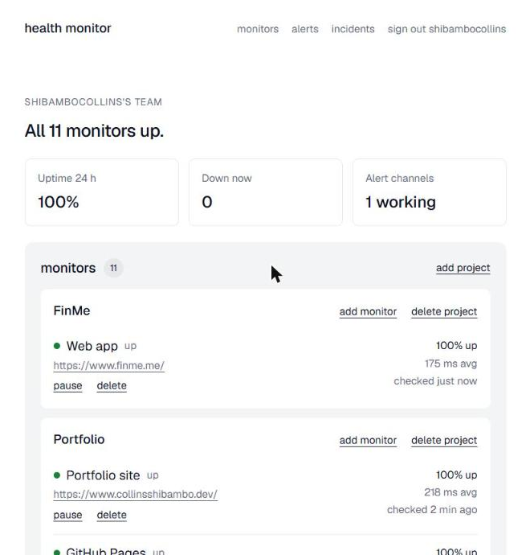
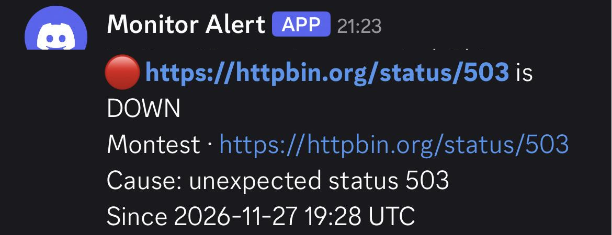
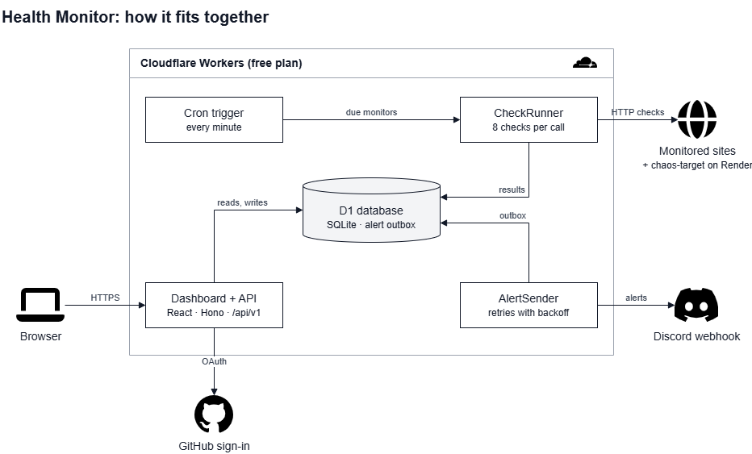

# Health Monitor

Uptime monitoring for small web apps. It checks your URLs every few minutes from Cloudflare's network and sends a Discord message when one goes down and when it comes back.

**Live:** https://uptime-app.uptime-app.workers.dev: choose **try the demo** to look around without signing in. The demo is read-only and shows my own projects, checked live.

This is a portfolio project, not a replacement for UptimeRobot or Better Stack. The point is the engineering: scheduling, a write budget, an alert outbox, SSRF defences and tests, all on free plans with no payment card.



## What it does

- **Projects and monitors.** Group the URLs of an app into a project. Each monitor has an interval (5 to 60 minutes), a timeout, an expected status code and a "slow" threshold.
- **State machine.** A monitor is `UP`, `DEGRADED` (slow) or `DOWN`. It goes `DOWN` after 3 failed checks in a row and back `UP` after 2 good ones, so a single timeout never alerts.
- **Fast confirmation.** After a first failure the monitor is checked again at the next tick, not after its interval, so a 5-minute monitor alerts about 2 to 7 minutes after an outage starts.
- **Discord alerts.** One message when an incident opens, one when it closes, with how long it lasted. Webhook URLs are encrypted at rest.
- **Dashboard.** 24-hour uptime, average response time and the last check for every monitor, plus recent incidents. It refreshes every minute.



## How it works



Everything runs in one Cloudflare Worker (source of the diagram: [`docs/architecture.drawio`](docs/architecture.drawio)).

1. **Every minute** a cron trigger claims the monitors that are due. The claim is one `UPDATE` that moves `next_run_at` an interval ahead, which doubles as a lease, so two overlapping ticks never check the same monitor.
2. **Checks run in groups of 8**, one group at a time, each in its own `CheckRunner` invocation. The free plan gives 10 ms of CPU per invocation, and each `fetch()` costs about 0.3 ms, so one invocation can't run 40 checks. Fanning out gives every group its own budget.
3. **Each group writes in one batch:** the hourly rollup, the monitor's new state, and, when it goes down or recovers, the incident and the queued alerts (an outbox table).
4. **After the checks**, if any alert is due, an `AlertSender` invocation sends up to 10. A failed send is retried after 1, 2, 4 ... 60 minutes (8 tries at most), a 429 waits as long as Discord asks, and a deleted webhook marks the channel broken. One broken channel never holds up the others.

The same Worker serves the React dashboard as static assets and the API under `/api/v1`, so the session cookie is first-party and there is no CORS.

## The free-plan budget

The binding limit is **D1's 100,000 rows written per day**. When it runs out, every query fails until midnight UTC, so the design is built around it:

- A healthy check costs **2 rows**: the claim and one hourly rollup upsert. The monitor row is only rewritten when its state or counters change, and raw check rows are only kept for failures.
- No index on `next_run_at`: in D1 an index costs an extra row on every write that touches it.
- The rollup table is `WITHOUT ROWID` with `PRIMARY KEY (monitor_id, hour)`, so the key is the table and there is no second index to write.
- Per-team caps (20 monitors, 20 projects, 5 channels) are enforced inside the `INSERT`, so concurrent requests can't get past them.

Measured over a 15-day soak test on the live database: **2.16 rows per check**, 21,596 of 21,600 ticks ran, tick CPU at most 7 ms with groups of 8. Full results: [`docs/phase-0-checklist.md`](docs/phase-0-checklist.md).

**Uptime %** is successful checks divided by all checks in the window, computed from the hourly rollups.

## Security

- **SSRF.** The checker fetches URLs that users type in. Only `http` and `https`; IP literals in private, loopback, link-local, CGNAT and cloud-metadata ranges are rejected (IPv6 and IPv4-mapped forms too); the hostname is resolved over DNS-over-HTTPS when a monitor is saved and rejected if any address is private. Redirects are not followed: a redirect counts as its own status code, so the expected status must match it. Known gap: Workers can't pin the resolved IP, so DNS rebinding is possible in theory; Cloudflare's own `global_fetch_strictly_public` blocks private addresses at fetch time (measured: 403 or 530, no request reached a private address).
- **Sign-in.** GitHub OAuth with `state` and PKCE (S256), no scopes, no passwords. Sessions are random 32-byte tokens in an `HttpOnly; Secure; SameSite=Lax` `__Host-` cookie; only their SHA-256 hash is stored.
- **Secrets.** Discord webhook URLs are encrypted with AES-GCM; the team id is bound in as additional data, so a ciphertext copied to another team fails to decrypt. Webhook URLs and tokens are never logged or returned by the API.
- **Access.** Every query is scoped to the caller's team, and tests check that one team can't read another's data. Writes only accept `application/json` (a CSRF defence) and are rate-limited (sign-in 10/min per IP, writes 20/min per user).

## chaos-target

[`apps/chaos-target`](apps/chaos-target) is a small service on Render that goes down, slows down and flaps on a fixed 2-hour schedule. Monitoring it measures the platform itself: time to detect, false alerts during flapping, and missed incidents.

## Tech

TypeScript (strict) · Cloudflare Workers · D1 (SQLite) · Hono · Zod · React + Vite · Vitest with `@cloudflare/vitest-plugin` (tests run in the Workers runtime against a real local D1) · GitHub Actions.

357 tests: the state machine and URL validator (`packages/core`, plain Node), the checker, API, alerts and delivery (`apps/app`, Workers runtime), and chaos-target. The state machine's cases are also kept as JSON in [`contract-tests/`](contract-tests) so a port to another language must pass the same cases.

## Run it locally

Needs Node 22.

```bash
npm ci
cp apps/app/.dev.vars.example apps/app/.dev.vars   # then fill it in (below)
cd apps/app
npx wrangler d1 migrations apply uptime --local
npm run dev        # Worker, local D1 and the last React build on :8787
npm run dev:web    # in a second terminal: Vite with hot reload on :5173
```

Checks: `npm run typecheck && npm run lint && npm test` from the repository root.

### Configuration

| Name                                       | Kind                | What it is                                                                                               |
| ------------------------------------------ | ------------------- | -------------------------------------------------------------------------------------------------------- |
| `GITHUB_CLIENT_ID`, `GITHUB_CLIENT_SECRET` | secret              | A GitHub OAuth App; its callback is `<APP_ORIGIN>/api/v1/auth/github/callback`                           |
| `CHANNEL_ENCRYPTION_KEY`                   | secret              | 32 random bytes, base64: `openssl rand -base64 32`. Replacing it makes saved Discord channels unreadable |
| `APP_ORIGIN`                               | var                 | The site's origin, used for the OAuth callback                                                           |
| `MAX_CHECKS_PER_TICK`                      | var                 | Checks per cron tick (40)                                                                                |
| `DEMO_TEAM_ID`                             | var                 | The team the read-only demo shows; leave it out to turn the demo off                                     |
| `DB`                                       | D1 binding          | The `uptime` database                                                                                    |
| `LOGIN_LIMITER`, `WRITE_LIMITER`           | rate-limit bindings | Sign-in and write limits                                                                                 |

In production, secrets are set with `npx wrangler secret put <NAME>` and never stored in the repository.

## Not built yet

Alert rules per project, SLOW alerts, email alerts (without a domain they could only reach the account owner), API keys, and a periodic DNS re-check. Design notes and the reasons behind each decision are in [`docs/DECISIONS.md`](docs/DECISIONS.md).
